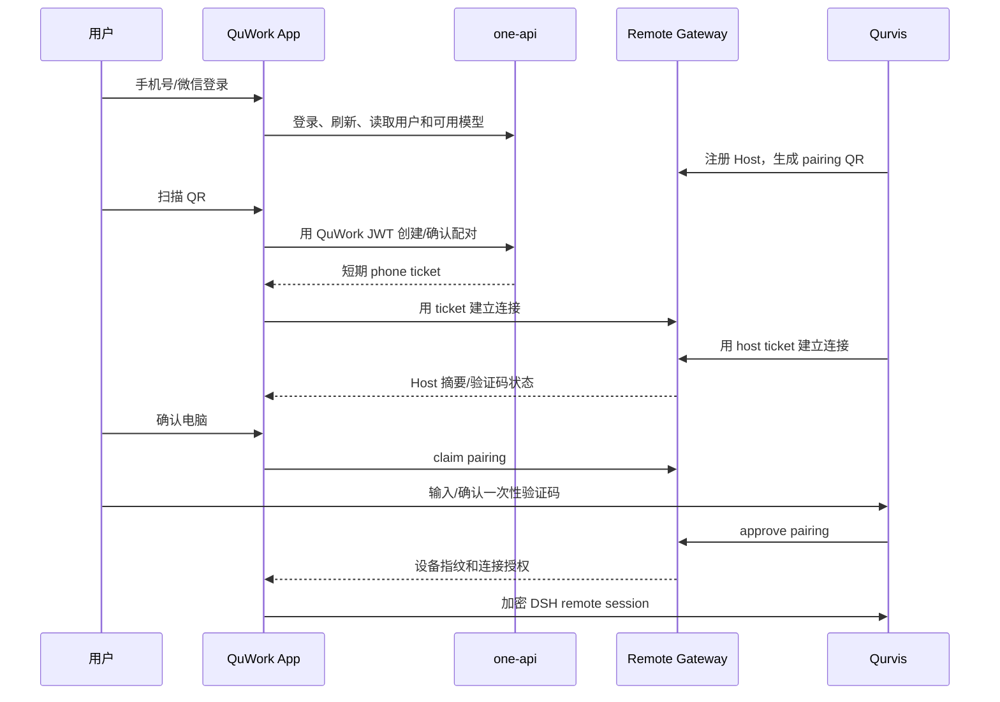

# QuWork 手机 App 二次开发计划 v2

> 状态：待确认。本文修正 v1 对 one-api 路由中间件继承范围的表述，并补充公网连接服务和 QuWork 账号兼容方案。当前仍只输出计划，不开始业务代码改造。
>
> 盘点日期：2026-11-18

## 1. v2 的关键结论

### 1.1 公网连接服务不是“小接口”

如果手机 App 和 Qurvis 电脑客户端需要跨公网连接，系统需要一套连接平面：配对、身份确认、短期票据、信令、NAT 穿透、Relay 回退、断线重连、设备撤销、日志和多实例部署。它不是在 one-api 增加一个 WebSocket handler 就结束的工作。

按工作量划分：

| 目标 | 规模 | 说明 |
|---|---|---|
| 单机 PoC：一个 WS 入口、固定域名、单实例、只跑基础转发 | 中等 | 可以较快验证 App ↔ Qurvis 的协议和鉴权，但不具备生产级容错和扩容能力 |
| 生产版公网连接：配对、Relay、断线恢复、设备撤销、多实例和监控 | 大 | 涉及 one-api、独立连接服务或现有 `ds-harness-remote` Server、Qurvis、Flutter App 和部署层 |
| 直接复用已有 `ds-harness-remote` Server/Relay | 中等偏大 | 连接协议和安全边界已有基础，但仍需 Qurvis Host 适配、QuWork 身份映射和部署接入 |

推荐把 one-api 作为账号和控制平面，把连接服务作为独立数据平面：

```text
手机 App ── HTTPS ──> one-api
    │                   ├─ 手机号/微信登录
    │                   ├─ 用户、模型、设备和短期配对票据
    │                   └─ token 刷新/撤销
    │
    └── WSS/WebRTC/Relay ──> QuWork Remote Gateway
                              ├─ 配对和信令
                              ├─ WebRTC 直连协商
                              ├─ Relay 回退
                              └─ 不读取 DSH 会话明文

Qurvis ── WSS/WebRTC/Relay ──> QuWork Remote Gateway
```

one-api 可以继续提供配对票据、设备列表和权限检查，但不建议让它承载长期运行的远控数据连接。这样可以避免 one-api 重启导致所有远控连接一起中断，也能让远控服务独立扩容和限流。

### 1.2 one-api 内嵌方案的中间件结论

根据 `main.go` 的注册顺序，以下结论作为 v2 的实现约束：

```text
server.Use(gin.Recovery())
server.Use(RequestId())
server.Use(Language())
server.Use(RequestBodyLimit())
server.Use(ApiAccessLog())
server.Use(sessions.Sessions(...))
router.SetRouter(server, buildFS)
```

`Engine.Use()` 追加到引擎级 `RouterGroup.Handlers`，所以之后注册的所有路由都会继承这些引擎级中间件。

| 中间件/位置 | WS 端点能否绕开 | v2 处理结论 |
|---|---:|---|
| `ApiAccessLog` | 否 | 必须在 `ApiAccessLog` 内增加远控路径前缀排除，或将连接服务拆成独立进程 |
| `RequestBodyLimit` | 否 | 保留引擎级执行；确认它只限制 HTTP 请求体，不读取或阻塞 WS 升级后的帧 |
| `sessions.Sessions` | 否 | 不依赖 Cookie 会话；远控使用短期 ticket/JWT/Noise 身份，避免把 session 当作设备授权 |
| `/api` 分组 gzip | 可以绕开 | WS 路由必须在 `/api` 分组之外 |
| `web.go` 内的引擎级 gzip | 取决于注册顺序 | 如果端点在 `SetWebRouter` 前注册，可避开该 gzip；在其后注册则会继承，必须显式确认 |
| `middleware.Cache()` | 通常无害但有隐患 | 远控路径排除缓存；避免给配对页、远控页面和版本相关响应设置 `max-age=604800` |
| 路由注册顺序 | 关键 | 方案 A 中把 WS 路由注册在 `SetWebRouter` 前、`/api` 外，并写测试锁定顺序 |

`gin-contrib/gzip` 会跳过 Upgrade 请求，但这不等于可以忽略 gzip 的注册范围：远控页面、HTTP fallback、错误响应和配对接口仍可能受到压缩/缓存影响。

## 2. 公网连接服务方案

### 2.1 方案 A：接入 one-api

适合：短期 PoC、单机部署、连接量小且希望减少新进程。

最小可行改造：

1. 新增独立远控路由组，例如 `/remote/v1/*` 或 `/connect/v1/*`，不放进 `/api`。
2. 在 `SetWebRouter` 之前注册 WS 端点，确保不继承 `web.go` 后续追加的 gzip。
3. 在 `ApiAccessLog` 增加路径排除/摘要日志规则，不能记录 query token、配对 ticket、WebSocket 帧和 Noise 密钥。
4. 为远控路径增加 Cache 排除；配对状态接口不能被共享缓存。
5. 为浏览器/原生 WebSocket 鉴权支持 `?ticket=` 或首帧鉴权，因为浏览器 WebSocket 不能自定义 `Authorization` header。query 中只能放短期一次性票据，服务端收到后立即换成连接级身份并清理日志。
6. 复用现有 JWT/Redis/MySQL，但把 Redis 中的配对会话、一次性 ticket、验证码、过期时间和消费状态单独命名空间管理。
7. 实现 WS 生命周期：升级、首帧鉴权、心跳、最大帧/消息限制、关闭原因、重连和优雅退出。
8. 如果要支持跨 NAT，增加 WebRTC signaling 和 Relay fallback；不能把普通 HTTP handler 当作完整的 NAT 穿透方案。
9. 为单实例连接建立基础集成测试，验证升级请求依次经过/跳过哪些中间件。

方案 A 的真正风险是生命周期和部署耦合：one-api 重启、发布、gzip/cache 改动、ApiAccessLog 改动或 Web 路由顺序变化都可能影响远控连接。

### 2.2 方案 B：独立 Remote Gateway（推荐）

适合：正式公网产品、需要多实例、需要独立发布和故障隔离。

one-api 只增加控制面接口：

```text
POST /api/remote/pairing/start       登录用户创建配对会话
GET  /api/remote/pairing/:id         查询配对状态
POST /api/remote/pairing/:id/claim   手机确认目标电脑
POST /api/remote/pairing/:id/approve 电脑提交一次性验证码
GET  /api/remote/devices              当前账号设备列表
DELETE /api/remote/devices/:id        撤销设备
POST /api/remote/connect-ticket       换取短期连接票据
```

Remote Gateway 负责：

- WS/WSS 长连接或 WebRTC signaling。
- 手机和 Qurvis 的配对 QR payload 解析。
- 连接级身份确认、心跳、限流、关闭和重连。
- WebRTC 直连失败后的加密 Relay 回退。
- 多实例之间通过 Redis/共享状态协调。
- 只转发已加密的 DSH remote frames；不解析聊天内容、文件内容或模型 token。

Gateway 不应直接信任客户端传来的 user id。它应验证 one-api 签发的短期连接票据，票据至少绑定：账号、设备、配对会话、角色（phone/host）、目标 Host、过期时间、一次性 nonce 和协议版本。

### 2.3 方案 C：已有 `ds-harness-remote` Server 作为连接层

如果 Qurvis 能实现现有 `packages/dsh_remote` 所需的 Host 端，方案 C 的工作量小于从零设计协议：

1. 复用 Server/Relay 的配对、Noise、WebRTC 和分帧协议。
2. one-api 只负责 QuWork 账号登录、设备/配对授权和短期身份票据。
3. Flutter App 继续使用现有 `RemoteAccount`、`RelayPairingBackend`、`remote_pairing_state.dart` 的大部分实现。
4. Qurvis 增加 Host 注册、QR 展示、claim/approve、授权同步和 DSH Host carrier 适配。
5. 在协议边界增加 QuWork account/device claims，不把 one-api JWT 直接当作 DSH remote 长期连接密钥。

这不是“零改造”：Qurvis 端的 Host 生命周期、设备指纹持久化、更新和网络恢复仍需要实现和测试。

### 2.4 推荐决策

首期不建议把完整 Relay 数据面塞进 one-api。建议按以下顺序落地：

1. 用现有 `ds-harness-remote` 协议做本地/LAN 或测试 Server 的端到端 PoC。
2. one-api 增加短期配对票据和设备授权控制面。
3. 若已有 Server 满足生产要求，直接部署并接入；否则抽取独立 QuWork Remote Gateway。
4. 只有在无法部署独立服务、且 PoC 必须单进程时，才采用方案 A，并先加入中间件排除和路由顺序测试。

## 3. QuWork 账号兼容改造

### 3.1 不要直接改造现有 `AccountState`

当前 `app/lib/state/account_state.dart` 的语义是：

```text
DSH Host account service
  -> account/startSignIn
  -> DeepSeek OAuth/PKCE
  -> Host credential store
  -> deepseek-account model route
```

它依赖本机 DSH Host、loopback callback、引擎 account API 和 DeepSeek 账号模型路由。把手机号/微信登录硬塞进此状态，会混淆两种身份：

- QuWork 服务账号：决定用户、套餐、可用模型、设备和公网连接权限。
- DSH Host/DeepSeek 账号：决定某个 Host 是否有 DeepSeek 官方账号凭据。

推荐新增独立的 `QuWorkAccountState`，保留现有 `AccountState`。等首期稳定后，再考虑抽取共享的“登录结果/错误展示”组件，而不是合并两个状态机。

### 3.2 建议的 QuWork 状态模型

建议文件：

```text
packages/quwork_api/lib/src/auth_api.dart
packages/quwork_api/lib/src/auth_models.dart
app/lib/state/quwork_auth_state.dart
app/lib/state/quwork_auth_storage.dart
app/lib/ui/auth/quwork_login_page.dart
app/lib/ui/auth/quwork_wechat_bind_page.dart
```

状态至少包含：

```dart
enum QuWorkAuthPhase {
  unknown,
  signedOut,
  restoring,
  sendingCode,
  captchaRequired,
  signingIn,
  wechatBindingRequired,
  refreshing,
  signedIn,
  signingOut,
  failed,
}

class QuWorkAuthState {
  final QuWorkAuthPhase phase;
  final QuWorkUser? user;
  final DateTime? accessTokenExpiresAt;
  final bool hasAccessToken;
  final bool hasModelCredential;
  final bool wechatBound;
  final QuWorkWechatBinding? pendingWechatBinding;
  final QuWorkAuthError? error;
}
```

其中：

- `accessToken`、`llm_token` 不直接放进 Riverpod state、日志、Widget 参数或普通 `SharedPreferences`；只保存在安全存储，状态只暴露 `hasAccessToken`、过期时间和可展示的账号信息。
- `pendingWechatBinding` 只保存短时 `wechat_token` 的内存引用或安全存储引用、过期时间和下一步用途；绑定完成、取消、登出或过期时清除。
- `refreshing` 是明确的单飞状态；同一时间只允许一个刷新请求，其他请求等待结果，不做无限重试。
- `failed` 需要稳定错误码，如 `network_unreachable`、`token_expired`、`wechat_bind_required`、`captcha_required`、`account_disabled`、`model_credential_missing`。

### 3.3 QuWork API 客户端

建议新增独立纯 Dart 包 `packages/quwork_api/`，不要把 one-api 账号接口混入 `packages/dsh_client`。

最小 API：

```dart
abstract interface class QuWorkAuthApi {
  Future<SendCodeResult> sendLoginCode(String phone, {String? aliyunCaptcha});
  Future<QuWorkLoginResult> loginByPhone(String phone, String code, {String? wechatToken});
  Future<WechatLoginStart> startWechatLogin();
  Future<WechatLoginResult> finishWechatLogin(Uri callback);
  Future<void> bindWechat(String wechatToken);
  Future<QuWorkUser> self();
  Future<TokenRefreshResult> refresh();
  Future<void> logout();
}
```

对应 one-api 接口：

| QuWork 客户端能力 | one-api 接口 |
|---|---|
| 手机发码 | `POST /api/sendVerifyCode?aliyun_captcha=...` |
| 手机登录/自动注册 | `POST /api/user/client/login` |
| 微信登录 URL | `GET /api/oauth/wechat/url`，或客户端按相同 state 规则构造可信回调 |
| 微信扫码回调 | `GET /api/oauth/wechat?code=&state=&platform=qurvis` |
| 未绑定微信的已有账号绑定 | `POST /api/oauth/wechat/login_bind` |
| 微信新用户手机号注册绑定 | `POST /api/oauth/wechat/register_bind` |
| 已登录账号绑定微信 | `POST /api/user/wechat/bind` |
| token 刷新 | `GET /api/user/refresh` |
| 当前用户资料 | `GET /api/user/self` |

API 客户端必须：

1. 所有请求带 `X-QurWork-Version`，是否继续传 `platform=qurvis` 由服务端契约确认。
2. 对未知 JSON 字段宽松解析，不能因 one-api 新增字段导致 App 登录失败。
3. 对 HTTP 状态和业务 `success:false` 分开归一，保留稳定错误码和用户可操作的下一步。
4. 将 `wechat_token` 视为一次性短期凭证，不能重试提交；失败后提示重新扫码。
5. 使用取消、超时和刷新单飞；登录页销毁时取消倒计时、浏览器监听和网络请求。
6. 对请求日志做字段级脱敏：`Authorization`、Cookie、token、`llm_token`、`wechat_token`、验证码、手机号只显示类型/长度，不显示值。

### 3.4 Token、刷新和凭据生命周期

one-api 当前登录响应包含 JWT `token`、`expire` 和 `llm_token`，并提供 `/api/user/refresh`。因此 App 需要分别管理两类凭据：

```text
QuWork access token/JWT
  -> 调 one-api 账号、模型、配对控制面
  -> 过期前刷新
  -> 刷新失败则清除登录态并回到登录页

llm_token
  -> 只用于 QuWork 模型 provider/Host 注入
  -> 不作为 UI 登录态判断
  -> 不进入 QR、诊断日志、剪贴板或普通偏好
```

需要在阶段 0 确认：

- `/api/user/refresh` 是否允许 JWT 过期后刷新，还是必须在过期前调用。
- 刷新后 `llm_token` 是否稳定，是否需要重新获取或通过用户 token API读取。
- App 退出登录是否需要服务端撤销 token，还是仅清除本机凭据。
- 多设备登录、设备撤销和账号封禁的服务端行为。

### 3.5 RootGate、主机和模型的兼容

建议调整启动依赖关系：

```text
RootGate
  ├─ 恢复 QuWorkAuthState
  │    ├─ signedOut -> QuWork 登录页
  │    ├─ refreshing -> 保持启动占位，不闪回登录页
  │    ├─ signedIn -> 加载用户模型/连接入口
  │    └─ failed -> 可重试或退出登录
  └─ DSH Host 状态
       ├─ 本机引擎可选启动
       ├─ Qurvis 远程 Host 可通过配对添加
       └─ DeepSeek account OAuth 仍是独立设置项
```

不要让 QuWork 登录强制要求本机 DSH 引擎先启动；公网远程 Host 场景下，用户可能只需要账号和已配对的 Qurvis。反过来，本机 DSH Host 的 DeepSeek OAuth 也不应被 QuWork 登出流程误删。

## 4. QuWork 模型与账号的联动

### 4.1 推荐数据流

```text
QuWork 登录
  -> /api/user/available_models
  -> QuWorkModelSnapshot（按账号和服务端版本缓存）
  -> 选择模型
  -> 使用 llm_token 配置 DSH provider/远程 Host
  -> DSH ModelCatalog 校验 provider + model
  -> 创建会话/切换模型
```

### 4.2 必须先确认的服务端契约

当前 `available_models` 只确认了“用户允许的模型 ID 列表”，还没有完全确认：

- OpenAI 兼容 Base URL 和 `/v1` 是否与 `/api` 同源。
- 模型 ID 是否能直接作为 DSH provider 的 model id。
- 是否有 reasoning/input/context window 等 DSH 所需元数据。
- 远程 Qurvis Host 是否由手机下发 provider 配置，还是由 Qurvis 自己从 one-api 拉取。
- `llm_token` 是否可以在手机端直接使用，还是必须通过 Host 侧安全注入。

建议首期只支持服务端明确声明的 QuWork provider profile；不把普通字符串模型列表直接伪装成完整 DSH `ModelInfo`。对缺失元数据的模型，使用保守默认值并在发送前做真实错误处理。

## 5. 公网配对和账号的联合流程



账号 JWT 只用于控制面；连接数据面使用短期角色 ticket 和现有 Noise/remote 身份。一个 QuWork 账号可以拥有多个 Host，但每个 Host 必须有独立设备记录、指纹和撤销状态。

## 6. 分阶段开发计划 v2

### 阶段 0：接口、部署和授权冻结

- 确认 one-api API Base URL、模型 Base URL、JWT refresh 行为和生产 CORS。
- 确认公网连接使用方案 B 还是方案 C；若坚持方案 A，先确认中间件排除和路由注册位置。
- 确认 Qurvis Host 是否实现 `ds-harness-remote` 兼容端。
- 确认微信网页扫码回调、AppID、回调域名和移动端浏览器策略。
- 确认阿里云滑块在目标移动平台的 SDK/回调可用性。
- 确认 Qurvis 源码授权和 QuWork 品牌/许可发布方式。

### 阶段 1：QuWork API 和账号状态

- 新增 `packages/quwork_api`，实现 API 模型、错误归一、请求脱敏和 mock transport。
- 新增 `QuWorkAuthState`、安全存储和 token refresh single-flight。
- 实现手机号登录、微信登录、未绑定微信分支、绑定微信、退出和恢复登录。
- 将 `RootGate` 接入 QuWork 登录状态，同时保留 DSH `AccountState`。

### 阶段 2：滑块与真机登录

- 将 Qurvis 的阿里云 SDK 接入 Flutter 可用的 WebView/系统浏览器桥，不直接在页面散落 SDK 代码。
- 处理 `aliyun_captcha` query、超时、重试、服务端关闭滑块和版本门槛。
- Android/iOS/OHOS 真机验证手机号发码、微信回调和 token 恢复。

### 阶段 3：模型注入与选择

- 读取 `available_models`，创建账号级模型快照。
- 确认并配置 QuWork provider 的 Base URL、`llm_token` 和模型元数据。
- 扩展现有 `model_sheet.dart`，支持 QuWork 模型、不可用状态和会话默认模型。
- 验证消息真实走 QuWork provider；不能只验证列表展示。

### 阶段 4：连接控制面

- one-api 增加配对会话、设备列表、短期 ticket、设备撤销和权限错误码。
- Redis key 命名空间、TTL、一次性消费、并发 claim 和过期清理补齐测试。
- 不在 one-api 日志中记录 QR 原文、token 或远控帧。

### 阶段 5：Remote Gateway/Qurvis Host

- 优先接入现有 `ds-harness-remote` Server/Relay，补齐 Qurvis Host 端。
- 实现 WS/WebRTC/Relay 的健康检查、心跳、断线恢复、优雅退出和多实例共享状态。
- App 复用现有扫码配对 UI 和状态机，增加 QuWork 登录身份及设备列表入口。
- 如果采用方案 A，增加 `ApiAccessLog`/Cache 排除和 SetWebRouter 前注册测试。

### 阶段 6：产品化与发布

- QuWork 品牌输入文件、应用 ID、图标、关于页、隐私/服务协议。
- AGPL、MIT、第三方来源、修改声明和源码获取方式同步。
- 完成公网压测、断线重连、设备撤销、账号封禁、token 失效和真机验收。

## 7. 代码改动清单

### 手机 App

```text
packages/quwork_api/
app/lib/state/quwork_auth_state.dart
app/lib/state/quwork_auth_storage.dart
app/lib/state/quwork_models_state.dart
app/lib/ui/auth/
app/lib/ui/account/
app/lib/ui/chat/model_sheet.dart
app/lib/ui/shell/root_gate.dart
app/lib/l10n/parts/*_zh.arb
app/lib/l10n/parts/*_en.arb
app/lib/remote/relay/...
```

### one-api 控制面

```text
router/remote.go
controller/remote_pairing.go
controller/remote_devices.go
middleware/remote_auth.go
model/remote_pairing.go
model/remote_device.go
service/remote_ticket/...
middleware/api-access-log.go
middleware/cache.go
router/router.go / router/web.go（按真实注册顺序调整）
```

这些是规划入口，不代表现有文件一定存在或必须按该文件名实现。接口 schema、错误码和 Redis key 应先定，再决定是否合并文件。

### Remote Gateway（推荐独立目录/仓库）

```text
cmd/remote-gateway/
internal/auth/
internal/pairing/
internal/signaling/
internal/relay/
internal/observability/
```

语言可以沿用 Go，也可以直接部署已有 `ds-harness-remote` Server；选择依据是复用程度、部署环境和协议兼容测试，不应先为了“统一语言”重写现有加密/分帧实现。

### Qurvis

```text
src/main/remote/host-registration.ts
src/main/remote/pairing-service.ts
src/main/remote/gateway-client.ts
src/shared/remote/schemas.ts
src/shared/remote/contracts.ts
src/renderer/.../remote-pairing/
```

Qurvis 的具体文件和目录必须以其仓库规则、现有 IPC 边界和授权状态为准；当前计划只定义职责，不复制其源码。

## 8. 风险和必须避免的错误

1. **把公网 Relay 当作普通 API**：HTTP handler、JWT 登录和 WebSocket 升级不等于完整远控协议。
2. **把 one-api JWT 放进 QR**：QR 只放短期一次性 ticket 或 pairing secret。
3. **把 `llm_token` 放进 App state 或远控帧日志**：模型凭据和账号登录凭据分开管理。
4. **直接把 QuWork 登录塞进 DSH `AccountState`**：会破坏本机 DeepSeek OAuth 和远程 Host 语义。
5. **依赖路由注册顺序但没有测试**：方案 A 必须写测试验证 WS 路由是否继承 `web.go` gzip、ApiAccessLog 和 Cache。
6. **只在 UI 测试模型列表**：必须发出真实聊天请求，确认 provider、token 和 model route 正确。
7. **新增无限重试**：登录、刷新、配对和 Relay 都需要明确超时、取消、退避上限和用户恢复路径。
8. **未经授权复制 Qurvis**：目前未发现 Qurvis 根目录 LICENSE，协议参考不等于源码授权。

## 9. 验证与验收

### 自动化检查

```bash
(cd app && flutter pub get && flutter analyze && flutter test)
(cd packages/quwork_api && dart pub get && dart analyze && dart test)
(cd packages/dsh_remote && dart pub get && dart analyze && dart test)
python3 app/tool/l10n_merge.py --check
python3 app/tool/guide_sync.py --check
```

若改动 one-api 或 Gateway，还需执行对应 Go/Node 单测、WebSocket upgrade 集成测试、Redis 并发/过期测试和构建检查。若改动 `app/ohos/` 或 `runtime/ohos/`，执行仓库规定的 ArkTS/鸿蒙门禁。

### 必须真机/真实环境验证

- 手机号发码、阿里云滑块、微信扫码回调、绑定和退出。
- access token 过期前刷新、刷新失败回登录、网络中断恢复。
- QuWork 模型列表、模型切换和真实聊天请求。
- Qurvis QR 展示、跨公网配对、WebRTC 直连、Relay 回退、重连和撤销。
- one-api 重启不应破坏控制面数据；Gateway 重启应有明确连接失败和恢复行为。
- 多实例时 Redis/票据/设备状态一致；日志中无完整 token、手机号验证码和 QR secret。

## 10. 待确认事项

1. 公网连接首期采用独立 Gateway、已有 `ds-harness-remote` Server，还是暂时内嵌 one-api。
2. 如果内嵌 one-api，远控路径前缀和 `ApiAccessLog`/Cache 排除点由谁维护，是否接受 `SetWebRouter` 前注册约束。
3. Qurvis 是否能实现/接入现有 `ds-harness-remote` Host 端。
4. one-api 是否新增配对控制面接口，还是由 Gateway 直接验证共享 JWT/短期 ticket。
5. `llm_token` 的使用方式：手机注入远程 Host、Qurvis 自己拉取，还是仅由 one-api 代理模型请求。
6. `/api/user/refresh` 的有效期和刷新规则，以及登出是否服务端撤销。
7. QuWork 是否保留 `platform=qurvis` 这一既有外部契约。
8. 首发平台范围和移动端微信/滑块 SDK 方案。

## 11. 下一步

用户确认 v2 后，建议按以下顺序开始：

1. 先冻结 one-api 控制面和 Gateway 的配对/token schema。
2. 再实现 `packages/quwork_api` 和 `QuWorkAuthState`，先跑手机号登录 mock/contract tests。
3. 接入真实 one-api 测试环境，完成微信和 token refresh。
4. 之后才开始模型 provider 注入和 Qurvis 公网配对，不先修改 DSH runtime 补丁。
