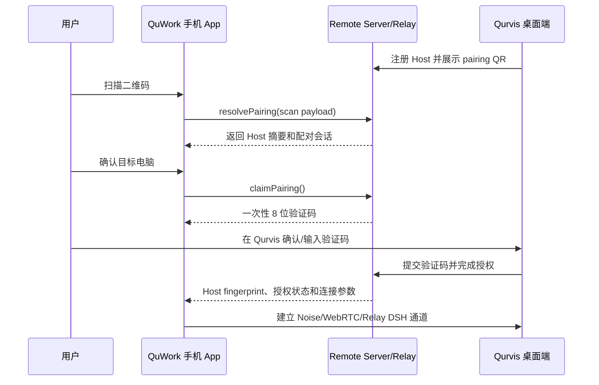

# QuWork 手机 App 二次开发计划

> 状态：待确认。本文是基于当前 `quwork-mobile`、`one-api` 和 `Qurvis` 工作区的代码盘点结果，当前阶段只输出计划，不开始业务代码改造。
>
> 盘点日期：2026-11-18

## 1. 目标与范围

目标是把当前 DSH Go Flutter App 改造为 QuWork 手机 App，首期完成以下闭环：

1. 用户在手机 App 内使用手机号验证码登录。
2. 用户使用微信扫码登录；未绑定微信时，能继续完成手机号绑定/注册。
3. 登录后从 QuWork 服务端读取当前账号可用模型，用户可以选择模型并用于聊天。
4. 用户在 App 内扫描桌面端 Qurvis 展示的二维码，使手机与桌面端建立连接。
5. 保留 DSH 引擎、聊天、会话和现有手机能力的稳定性，同时替换面向 DSH Go/DeepSeek 账号的产品外壳、账号入口和模型来源。
6. 处理开源许可证、第三方声明、品牌素材和再发布所需的法律文本。

本计划不把 `one-api` 或 `Qurvis` 的业务代码直接复制到 Flutter 工程；先以 HTTP/JSON 协议对接。需要复用源码时，必须先完成来源、许可证和必要授权确认。

## 2. 当前项目盘点

### 2.1 当前 App 已有能力

| 领域 | 已有入口 | 对 QuWork 的意义 |
|---|---|---|
| Flutter 外壳 | `app/lib/main.dart`、`app/lib/app.dart`、`app/lib/ui/shell/` | 可保留作为产品壳，但要替换名称、图标、关于页和登录落地流 |
| 本机/远程 DSH 连接 | `app/lib/state/connection_state.dart`、`app/lib/state/hosts_state.dart` | 可继续承载聊天和会话，不应在登录页中直接拼装连接状态 |
| DSH 账号登录 | `app/lib/state/account_state.dart`、`app/lib/state/account_api.dart` | 这是 DeepSeek 引擎账号 OAuth，不能当作 QuWork 账号；需要新增独立 QuWork 账号域 |
| DSH 模型目录 | `app/lib/state/models_state.dart`、`app/lib/state/providers_state.dart`、`app/lib/ui/chat/model_sheet.dart` | 已有选择 UI 和引擎路由模型，需要增加 QuWork 模型映射/注入层 |
| 扫码配对 | `app/lib/state/remote_pairing_state.dart`、`app/lib/ui/remote/pairing_page.dart`、`app/lib/remote/relay/dsh_remote_backend.dart` | 已有完整的“扫描 → 确认电脑 → 显示一次性验证码 → 等待配对”流程，可优先复用 UI 与状态机 |
| 远程协议 | `packages/dsh_remote/` | 当前基于 `ds-harness-remote` Server/Relay/Noise/WebRTC 协议；Qurvis 必须实现兼容 Host 端或提供适配协议 |
| 安全存储 | `app/lib/remote/secret_store.dart` 等 | QuWork access token、refresh/token 轮换凭据只能进入安全存储，不能写普通偏好或日志 |
| 双语文案 | `app/lib/l10n/parts/*.arb` | 登录、验证码、模型和配对文案必须中英文同步并运行 l10n 检查 |

### 2.2 当前架构上的主要差距

1. 当前 App 的 `AccountState` 只面向 DSH Host 的 DeepSeek OAuth，无法表示 QuWork 手机号/微信登录、账号 token、绑定状态和刷新状态。
2. 当前 DSH 模型目录来自 `session/modelCatalog`，而 `one-api` 的用户模型来自 HTTP 账号接口；两者的模型 ID、路由、凭据归属和失效条件需要明确映射。
3. 当前扫码配对依赖 `ds-harness-remote` 的远程 Server。盘点 Qurvis 时未在已检索的 `src/main` 认证/网络路径中发现与 Flutter App 同名的扫码配对入口，因此 Qurvis 端需要补齐 Host 侧兼容实现，或双方另行确定新的直连/LAN 契约。
4. 当前 App 的品牌、关于页、README、应用标识和资源仍是 DSH Go；仅替换显示名称不足以完成产品改造。

### 2.3 修改范围结论

| 结论 | 当前内容 | 处理方式 |
|---|---|---|
| 必须修改 | 产品名称、图标、启动页、关于页、登录落地流、QuWork 账号状态、one-api API 客户端、模型来源/注入、登录和模型文案 | 首期实现范围 |
| 需要与 Qurvis/服务端联动修改 | Qurvis 的 Host 配对注册与 QR、one-api 的移动端回调配置、QuWork 模型 Base URL/`llm_token` 使用方式 | 先定协议再改代码；不能只改手机端 |
| 可以复用 | DSH 聊天/会话 UI、`packages/dsh_client`、本机运行时、已有模型选择器外壳、`remote_pairing_state.dart` 的配对状态机和扫码页、SSH/Relay 通信实现 | 保持边界，按需接入 QuWork 数据 |
| 首期不要修改 | `runtime/patches/`、DSH 引擎桥核心协议、聊天流折叠逻辑、手机操控安全门、Android/鸿蒙运行时字节、`packages/dsh_client` 的 DSH Host wire protocol | 除非模型注入或 Qurvis 配对验证证明必须改，否则不动 |
| 暂不能复制 | Qurvis 源码、压缩 SDK 以外的专有资源和配置 | 当前未找到 Qurvis 根许可证；只参考公开接口行为，等待授权 |

因此，第一批代码改造应集中在“新增 QuWork API/账号域、登录 UI、模型适配和品牌输入文件”，不应从运行时或聊天渲染层开始重构。

## 3. `one-api` 接口盘点

以下是从 `/Users/wujihuan/work/rrzu/one-api` 路由和控制器确认的接口。实际开发前仍应以部署环境的 OpenAPI/接口测试为准，尤其是域名、Cookie 策略、CORS、微信回调地址和 token 过期时间。

### 3.1 手机验证码登录

#### 发送验证码

```http
POST /api/sendVerifyCode?aliyun_captcha=<base64-token>
Content-Type: application/x-www-form-urlencoded

phone=13800138000&type=login
```

- `type` 支持 `login`、`register`，登录流程固定传 `login`。
- 服务端校验手机号格式、Redis、IP 频率、手机号冷却和短信发送结果。
- 成功响应为 `{success: true, message: ..., data: null}`，不会返回验证码明文。
- `aliyun_captcha` 必须放 URL query；放在请求体中服务端取不到。
- `AliyunCaptchaCheck` 在服务端开启时读取该 query，并调用阿里云服务端校验。
- `X-QurWork-Version >= 1.1.0` 时，如果服务端启用滑块而请求没有参数，会直接拒绝发码。

#### 登录/注册

```http
POST /api/user/client/login
Content-Type: application/json
X-QurWork-Version: <app-version>

{
  "phone": "13800138000",
  "verification_code": "123456",
  "platform": "qurvis",
  "device_identifier": "<optional-device-id>",
  "device_uuid": "<optional-registered-device-uuid>",
  "channelId": "<optional-channel>",
  "wechat_token": "<optional-one-time-wechat-token>"
}
```

- 已注册用户登录；手机号不存在且允许注册时，接口会注册并登录。
- `wechat_token` 是微信扫码后服务端发出的 Redis 一次性临时凭证，不是长期 token。
- `platform: qurvis` 是现有服务端奖励、归因和兼容逻辑使用的外部契约；在 QuWork 手机 App 中是否继续上报该值，需要产品/后端确认。不能未经确认改成 `quwork`。
- 成功数据由 `SetupClientLogin` 返回，包含 `user`、JWT `token`、`expire` 和 `llm_token`。
- `llm_token` 是模型调用凭据，必须按敏感凭据处理，不能进入诊断日志、剪贴板、普通偏好或二维码内容。

### 3.2 微信登录、绑定和回调

已确认的路由：

| 接口 | 用途 |
|---|---|
| `GET /api/oauth/wechat/url` | 生成微信开放平台扫码 URL；服务端写入 state，返回 `{success,data:{url}}` |
| `GET /api/oauth/wechat` | 微信扫码回调；传 `code`、`state`、`platform`、可选 `channelId`，已绑定用户直接签发客户端登录 token |
| `POST /api/oauth/wechat/register_bind` | 微信未绑定账号时，手机号验证码注册并绑定微信；主要面向用户名/密码注册路径 |
| `POST /api/oauth/wechat/login_bind` | 微信未绑定账号时，手机号验证码登录已有账号并绑定微信 |
| `POST /api/user/wechat/bind` | 已登录用户用一次性 `wechat_token` 绑定微信，不需要再次提交手机号验证码 |

`GET /api/oauth/wechat` 对未绑定微信的账号返回失败业务响应，但 `data` 中带：

```json
{
  "wechat_token": "<one-time-token>",
  "bind_type": "need_bind"
}
```

App 需要把该状态转成“先输入手机号并获取验证码，再绑定/登录”的明确流程，不能把业务失败当成网络错误。

当前 one-api 使用的是微信开放平台网页扫码 (`snsapi_login`) 和服务端 `code -> access_token -> unionid/openid` 流程；这不是原生微信 `wx.login` SDK 流程。移动端首期建议使用系统浏览器/Custom Tab 或受控 WebView 承载回调，具体方式须结合微信开放平台配置确认。

### 3.3 模型接口

已确认：

```http
GET /api/user/available_models
Authorization: Bearer <one-api-jwt>
```

返回当前用户分组允许的模型 ID 列表，响应形态为 `{success:true, message:"", data:[...]}`。

另有：

```http
GET /api/models
Authorization: Bearer <one-api-jwt>
```

该接口返回渠道模型映射，当前控制器实现是 `DashboardListModels`，数据结构和 `available_models` 不同，不能直接混用。

`one-api` 还提供 OpenAI 兼容的 `/v1/models` 和聊天转发路由，但 QuWork 手机 App 如何使用 `llm_token` 访问这些路由、Base URL 是什么、是否允许用户切换到全部可用模型，需要在接口契约确认阶段固定下来。

## 4. 滑块验证码 SDK 与接入结论

### 4.1 已找到的 SDK 与 Qurvis 实现

Qurvis 已有完整的阿里云滑块接入，关键位置如下：

- SDK 资源：`/Users/wujihuan/work/rrzu/Qurvis/src/renderer/features/auth/aliyun_captcha_skd.js`。
- 配置来源：`Qurvis/src/main/config/api-config.ts`、`runtime-config.ts`，以及 `main.ts` 组装的 `region/prefix/sceneId`。
- IPC 暴露：`authGetCaptchaConfig`，由 `register-auth-ipc.ts` 返回只读配置。
- Renderer 调用：`src/renderer/stores/auth-store.ts`。
- 发码参数：`AuthApiClient.sendLoginCode(phone, aliyunCaptcha)` 将结果编码后放到 `/api/sendVerifyCode?aliyun_captcha=...`。
- 测试：`tests/main/auth-api-client.test.ts` 已断言 query 参数名、编码方式和请求体不放 `aliyunCaptcha`。

### 4.2 Flutter App 的建议边界

不要把阿里云 SDK 压缩 JavaScript 直接散落到 Dart 登录页。建议新增可替换的领域接口：

```text
QuWorkCaptchaProvider
  ├─ disabled：服务端未开启时直接发码
  ├─ aliyunWeb：使用受控 WebView/浏览器页完成滑块并回传 token
  └─ test：单测中返回固定假 token，不接真实服务
```

实现前必须确认阿里云 SDK 的移动 WebView 支持、域名白名单、回调事件和 Android/iOS/OHOS 的网络权限。若 SDK 只保证桌面 Web，备选方案是由 one-api 提供 QuWork 专用的人机验证页面/接口，App 只消费短时验证票据。

## 5. Qurvis 桌面端与扫码连接

### 5.1 已确认的 Qurvis 账号接入方式

Qurvis 已实现与 one-api 的以下契约：

- `src/main/auth/auth-api-client.ts`：手机号发码、`/api/user/client/login`、微信回调、刷新、自身信息、绑定微信。
- `src/main/auth/account-service.ts`：账号状态、`wechat-binding-required`、一次性 `wechat_token`、登录/绑定状态机。
- `src/main/auth/wechat-auth.ts`：生成 state、监听可信 API 域名回调、区分登录和绑定用途。
- `src/renderer/features/auth/aliyun_captcha_skd.js`：滑块 SDK。
- 请求统一带 `X-QurWork-Version`；手机号登录上报 `platform: qurvis` 和设备标识。

这些文件可以作为接口行为参考，不能在未确认 Qurvis 仓库授权的情况下直接复制实现。盘点时没有发现 Qurvis 根目录 `LICENSE` 文件；因此暂按“只能参考协议和行为、不能默认复制源码”处理。

### 5.2 推荐的扫码连接方案

优先复用当前 App 的 `packages/dsh_remote` 配对协议：



需要 Qurvis 端新增或接入与 `ds-harness-remote` Host 插件相同的注册、QR payload、claim、验证码和授权同步能力。若产品要求“同一局域网无需公共 Server”，应另立协议，不要在现有 `RemoteServerApi` 中混入未定义的直连分支。

### 5.3 连接安全要求

- QR payload 只保存短时 ticket/服务器地址，不放长期 one-api token、`llm_token` 或账号 Cookie。
- 手机在确认页显示电脑名称、平台、服务器和指纹摘要；用户确认后才 claim。
- 配对码一次性、短时有效，错误后让用户重新生成，不做无限重试。
- 成功后保存 Host 公钥/指纹，连接使用已有 pinning 和 Noise/WebRTC 安全边界。
- 日志、诊断包和错误文案不得回显二维码原文、配对密钥和 token。

## 6. 推荐的代码改造分层

遵循当前项目的 Riverpod 和纯 Dart 分层，不把网络请求直接写进 Widget。

### 6.1 新增纯 Dart QuWork API 包

推荐新增 `packages/quwork_api/`，职责只包括：

- one-api HTTP 客户端、宽松 JSON 解析和稳定错误码。
- 手机号发码/登录、微信 URL/回调、微信绑定、token 刷新、用户信息。
- `available_models` 与模型访问能力接口。
- `X-QurWork-Version`、`Authorization`、超时、取消和重试边界。
- 不保存 token，不打印完整请求体；由 App 注入安全存储和时间源。

不建议把 one-api 业务 API 塞进 `packages/dsh_client`，因为后者是 DSH Host 协议客户端，混入账号服务会扩大耦合和测试面。

### 6.2 App 状态与 UI

建议新增或调整：

| 位置 | 计划职责 |
|---|---|
| `app/lib/state/quwork_auth_state.dart` | QuWork token、用户、登录阶段、微信绑定状态、刷新和登出；与现有 `account_state.dart` 并列，不替换 DSH Host 账号状态 |
| `app/lib/state/quwork_models_state.dart` | 拉取/缓存账号可用模型，按账号与服务端版本失效；处理当前模型不可用 |
| `app/lib/ui/auth/` | 手机号登录、验证码倒计时、微信扫码回调、绑定手机号、滑块状态和错误展示 |
| `app/lib/ui/account/` | QuWork 用户资料、登录状态、退出与 token 失效处理；复用已有页面框架 |
| `app/lib/ui/chat/model_sheet.dart` | 在现有模型选择器中显示 QuWork 模型，并将选择写入 DSH provider/会话默认模型 |
| `app/lib/state/connection_state.dart` | 仅在确定 Qurvis Host 协议后接入新的 Host 来源；保留现有本机/SSH/Relay 装配点 |
| `app/lib/l10n/parts/*_zh.arb`、`*_en.arb` | 双语文案输入；生成文件不手改 |
| `THIRD_PARTY_NOTICES.md`、`ASSETS.md`、README/关于页 | 新产品名称、修改声明、第三方许可和品牌替换说明 |

### 6.3 模型选择的建议数据流

```text
QuWork 登录 token
  -> GET /api/user/available_models
  -> QuWork 模型快照（账号/服务端版本/时间）
  -> 使用 llm_token 配置 DSH Host 的 QuWork provider
  -> DSH session/modelCatalog 与 QuWork 列表取交集
  -> App 模型选择器
  -> 发送前再次校验模型仍可用
```

这里的“配置 DSH Host provider”需要结合 DSH 当前 provider API 和 one-api OpenAI 兼容 Base URL 落实；不能只把 `available_models` 字符串塞进 UI，否则聊天请求可能仍走旧的 DeepSeek 账号路由。

## 7. 开源协议与品牌处理

### 7.1 当前项目中可以保持的许可

| 范围 | 当前许可/状态 | QuWork 改造要求 |
|---|---|---|
| 仓库主体 | AGPL-3.0，根目录 `LICENSE` | 修改和分发主体代码时继续保留 AGPL-3.0、版权和修改声明；不能仅因改名改成闭源或删除源码提供义务 |
| `sdk/plugin-kit/`、示例 | MIT（README 已说明） | 可继续 MIT，但保留原版权和许可文本 |
| `packages/dsh_remote` | MIT，另有 `LICENSE-ds-harness-remote` | 保留 MIT 文本和上游来源/修改说明 |
| `packages/dartssh2` | 上游 MIT，已修改 | 保留上游 LICENSE、`VENDORED.md` 和修改说明 |
| `runtime/bridge/dsh-go-bridge` | 包内 MIT/预置 NOTICE 等 | 按目录现有 NOTICE 和第三方清单继续分发 |
| `THIRD_PARTY_NOTICES.md` 中其他组件 | 各自 MIT/Apache/AGPL/Unicode 等 | 不要合并成一份“QuWork 专有许可”；保持逐项声明 |

### 7.2 必须处理的内容

1. **主体许可不能只改名字**：`LICENSE` 的 AGPL 条款应保留；README、贡献说明、关于页和发行页面要写明“QuWork 是基于 dsh-Go 的修改版”，并列出修改范围。
2. **品牌素材必须替换**：`ASSETS.md` 已明确 DSH Go 名称、Logo、Deepy/鲸娘等不在 AGPL 授权范围内。QuWork 发布前应替换 App 名称、图标、启动图、吉祥物、截图和相关资源，或取得明确授权；不能直接把原品牌一起发布。
3. **第三方声明要同步**：新增 `one-api` 客户端协议适配时，如果只调用 HTTP 接口，不需要把 one-api 源码复制进本仓库；如果复制 MIT 代码，必须把 one-api MIT LICENSE 和版权归属加入声明，并保留原文件许可。
4. **Qurvis 源码暂不复制**：目前未找到 Qurvis 根目录 LICENSE。除非取得书面授权或补充明确许可证，否则只参考其接口契约和行为，不复制源码、资源、测试夹具或专有配置。
5. **服务端 AGPL 边界需单独评估**：如果 QuWork 还会修改并部署 AGPL 覆盖的网络服务，面向网络用户提供服务时要准备对应源码获取方式。商业闭源模块与 AGPL 代码的组合方式、App 与服务端的边界应在发布前做法律审查。
6. **凭据和配置不入库**：one-api 的微信 App Secret、阿里云 AccessKey、短信配置、Redis、JWT 密钥和生产 API 域名凭据不能复制到 App 或本仓库。

这部分是工程合规清单，不替代针对具体发行方式的法律意见；发布闭源增值服务、App 商店版本或托管服务前应让权利人/律师确认组合和源码提供方式。

## 8. 分阶段实施计划

### 阶段 0：契约和授权确认

- 固定 one-api 的测试/生产 Base URL、CORS、JWT 刷新、微信回调域名和模型 Base URL。
- 明确移动端微信方案：网页扫码回调、微信原生 SDK，还是后端生成中转页。
- 明确 Qurvis 扫码连接方案：复用 `ds-harness-remote` Server，还是新增局域网协议。
- 确认 QuWork 是否继续使用 `platform=qurvis`、`X-QurWork-Version` 和现有渠道字段。
- 确认 QuWork 发布许可、源代码提供地址、品牌素材归属和 Qurvis 源码授权。

### 阶段 1：产品外壳和基础配置

- 替换 App 名称、包名/应用标识、图标、启动资源、关于页和深链 scheme。
- 保留 DSH Go 的第三方来源说明，增加 QuWork 修改版说明。
- 建立 `packages/quwork_api` 的 API 类型、错误码和 mock transport。
- 建立 QuWork token 安全存储、恢复、刷新和登出骨架。

### 阶段 2：手机号和微信登录

- 实现手机号发码、倒计时、登录/自动注册、JWT 恢复和失效处理。
- 实现滑块 provider 与阿里云配置读取；先完成 mock/contract tests，再接真实 SDK。
- 实现微信扫码 URL、可信回调、state 校验、已绑定登录和未绑定手机号绑定流程。
- 登录成功后刷新用户资料、账号模型列表和 DSH provider 凭据。

### 阶段 3：模型目录和选择

- 对接 `/api/user/available_models`，建立账号模型快照和缓存失效规则。
- 以 `llm_token` 配置 QuWork OpenAI 兼容 provider，明确 token 只在 Host/安全存储边界内流转。
- 将 QuWork 模型与 DSH `ModelCatalog` 做显式映射，在模型选择器中显示来源、可用性和失败原因。
- 新会话默认模型、当前会话切换和模型不可用时的恢复路径补齐测试。

### 阶段 4：Qurvis 扫码连接

- 先在 Qurvis 端实现/启用与 `packages/dsh_remote` 兼容的 Host 注册和 pairing QR。
- 在 App 端复用现有 pairing 页面和状态机，只补 QuWork 登录身份、Host 选择和错误文案。
- 完成指纹确认、一次性验证码、授权同步、连接恢复和设备撤销。
- 如果选择 LAN 直连，另建独立协议包和安全评审，不把未定协议塞进现有 Relay API。

### 阶段 5：产品化和发布门禁

- 中英文 l10n、隐私/服务条款入口、账号注销/退出、诊断脱敏和权限说明。
- 更新 `README.md`、`CONTRIBUTING.md`、`THIRD_PARTY_NOTICES.md`、`ASSETS.md` 与 App 内开源许可页。
- Android、iOS、鸿蒙分别检查回调、浏览器、相机、网络、后台连接和安全存储能力。
- 完成真实 one-api 测试环境、真实微信测试账号、真实 Qurvis 实例和真机验收。

## 9. 验证计划

代码改造后按实际改动面执行，至少包括：

```bash
# Flutter App
(cd app && flutter pub get && flutter analyze && flutter test)

# 新增纯 Dart QuWork API 包（包名确定后替换路径）
(cd packages/quwork_api && dart pub get && dart analyze && dart test)

# 现有远程协议
(cd packages/dsh_remote && dart pub get && dart analyze && dart test)

# 文案与指南
python3 app/tool/l10n_merge.py --check
python3 app/tool/guide_sync.py --check

# 引擎桥/运行时若涉及
node --test runtime/tests/*.test.mjs

# 鸿蒙改动时
tooling/ohos/check-arkts.sh --sdk <OpenHarmony SDK> --hms-stubs
```

还需要单独记录自动化测试无法替代的环境验收：

- Android/iOS/OHOS 真机手机号登录、滑块、微信扫码回调、token 刷新和登出。
- 真实 one-api Redis/短信/微信配置下的过期、限流、重复绑定和账号封禁场景。
- Qurvis 真实桌面端展示 QR、手机扫码、验证码确认、连接恢复和设备撤销。
- 模型切换后实际消息请求确实走 QuWork 模型，而不是旧 DSH 账号路由。
- 发布 APK/安装包中的许可证页、第三方声明、品牌资源和源码获取入口。

## 10. 待确认问题与下一步

开始阶段 1 之前需要确认：

1. one-api 的测试/生产 API Base URL，以及 `/v1` 模型转发 Base URL 是否与账号 API 同源。
2. QuWork 手机 App 是否继续向 one-api 上报 `platform=qurvis`，还是由后端新增 `platform=quwork` 兼容值。
3. 微信登录是否接受网页扫码/Custom Tab；是否已有移动端微信开放平台 AppID 和回调域名。
4. 阿里云滑块是沿用 Qurvis 的 Web SDK，还是由后端提供移动端验证页面/票据接口。
5. Qurvis 是否愿意实现 `ds-harness-remote` Host pairing，还是要设计新的 LAN/公网连接协议。
6. 用户模型选择是只允许 one-api 的 `available_models`，还是还要保留用户自定义 OpenAI/Anthropic provider。
7. QuWork 首发平台范围是 Android，还是同时包含 iOS 和鸿蒙。
8. 发布时是否公开源码、源码托管地址和品牌素材授权证明由谁负责维护。

用户确认本计划和上述关键选项后，下一步先实现阶段 0 的接口契约与授权清单，再进入手机号登录最小闭环；不会先改动运行时补丁或大范围重命名。
