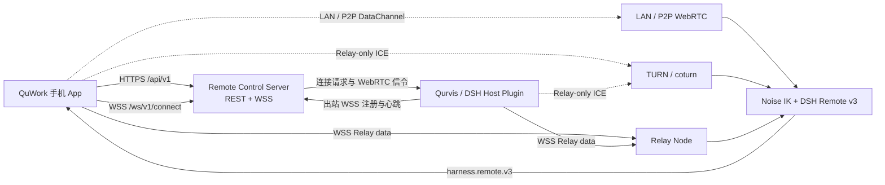

# QuWork 手机连接桌面 Host 服务部署与成本方案

> 状态：待运维、后端和客户端共同评审。本文只讨论服务选型、服务器配置、协议对接和上线步骤，不修改代码。
>
> 盘点日期：2026-11-19
>
> 目标协议：当前 App 的 `packages/dsh_remote` / `ds-harness-remote` Remote Server、Host Plugin、Noise IK、WebRTC、TURN 和 Relay 链路。

## 1. 先给结论

如果 QuWork 要继续复用当前 App 的连接流程，首期最划算的方式是：

```text
自建兼容 ds-harness-remote 的控制 Server
    + 自建或托管 Relay 节点
    + 使用托管 TURN 或部署 coturn
    + QuWork 后端只做账号映射和一次性授权
```

也就是：**购买基础设施服务，自己掌握 Remote Server 和账号边界；不要购买一个无法接入 QuWork 身份和协议的黑盒远程服务，也不要从头重写 Noise/WebRTC/Relay 协议。**

推荐顺序：

1. 内部 PoC：单台 VPS，先跑 Relay-only，验证手机、Server、Qurvis Host 和 `harness.remote.v3` 全链路。
2. MVP：控制 Server 与 Relay 分离，接入 TURN，使用稳定域名和 HTTPS/WSS。
3. 正式版：QuWork 账号通过一次性 exchange ticket 接入 Remote Server，增加多区域 Relay、限额、监控和高可用。

如果只是少量内部用户、且可以接受每台电脑配置一个公网隧道，之前的“Qurvis 内置 Gateway + Cloudflare Named Tunnel/FRP”方案启动成本更低。但它不是当前 `packages/dsh_remote` 的同一协议，需要新增 Gateway 客户端和设备凭据模型；面向正式产品不建议同时维护两套连接协议。

## 2. 当前连接链路和服务职责

当前 App 的远程连接不是简单的“手机请求电脑端口”，而是控制面、传输面和端到端加密三层组合。



### 2.1 控制 Server

控制 Server 负责：

- 账号登录或 QuWork 身份交换；
- 手机设备和 Host 设备注册；
- Host 列表、在线状态、版本和 Noise 公钥；
- Host 成员关系和授权；
- `wss://<origin>/ws/v1/connect` 控制连接；
- `connect.request`、`connect.accepted`、心跳、断线和连接替换；
- WebRTC 信令转发；
- TURN 临时凭据签发；
- Relay 节点分配和一次性 Relay ticket；
- 配对二维码、claim、验证码和设备撤销；
- 审计日志和限流。

控制 Server **不应该**转发所有聊天数据。正常情况下，业务数据经过 WebRTC 或 Relay，并在 Noise IK 之后加密；控制 Server 只转发控制帧和必要的信令。

### 2.2 Host 端

Qurvis 或桌面 Host 需要：

- 运行 DSH Web 和兼容版本的 Remote Host Plugin；
- 持久保存 Host 的 X25519 Noise 身份密钥；
- 主动连接控制 Server，发送注册信息和心跳；
- 声明 `transport.lan`、`transport.p2p`、`transport.turn`、`transport.relay` 等能力；
- 在连接后声明 `harness.remote.v3`；
- 接受手机侧的 Noise IK 握手和 DSH RPC/mux；
- 在退出、撤销或网络变化时正确释放连接和 WebRTC 状态。

Host 默认只需要出站访问 HTTPS/WSS。LAN/P2P 需要 WebRTC 的候选地址；TURN 和 Relay 由服务端提供，不要求用户手工开放入站端口。

### 2.3 手机端

当前手机端已在 `packages/dsh_remote` 中实现：

- Server 登录和 token 刷新；
- Host 列表和 Noise 公钥读取；
- 首次指纹确认和公钥 pinning；
- `connect.request` / `connect.accepted`；
- LAN/P2P → TURN → Relay 的回落；
- Noise IK；
- `harness.transport.describe` 和 `harness.remote.v3` 检查；
- 最终包装为普通 `DshClient`。

因此首期服务端应尽量兼容现有协议，而不是要求 App 重新设计连接层。

## 3. 三种购买/自建方式比较

| 方案 | 做法 | 首次开发 | 服务器成本 | 长期维护 | QuWork 身份接入 | 建议 |
|---|---|---:|---:|---:|---:|---|
| A. 购买已有托管 Remote Server | 直接使用第三方或上游托管 Server、Relay、TURN | 最低 | 按账号/流量计费 | 低 | 受供应商限制 | 只适合内部试用或验证协议 |
| B. 自建兼容 Server + 托管 TURN/Relay | 部署已有 `ds-harness-remote` Server，自己掌握域名和账号；购买 VPS、托管 TURN 或云中继 | 中 | 中 | 中 | 可做 exchange ticket | **首期推荐** |
| C. 完全自研后端 | 自己重写账号、配对、WebSocket、Relay、TURN 编排、Noise/协议适配 | 最高 | 中到高 | 最高 | 最灵活 | 不建议作为首期 |
| D. Qurvis Gateway + 隧道 | 每台电脑运行 Gateway，通过 Named Tunnel/FRP/反向代理暴露 | 手机和桌面端都要改 | 低到中，按隧道和流量 | 中 | 容易做独立设备 token | 仅适合小规模 PoC |

### 3.1 购买已有托管服务的优缺点

优点：

- 不需要立即维护公网 WebSocket、Relay 和 TURN；
- 上线时间最快；
- 可以先验证 Qurvis Host Plugin 和 App 的协议兼容性。

缺点：

- 账号体系、设备目录、域名、数据留存和审计受供应商控制；
- 不一定支持 QuWork JWT 或一次性 exchange ticket；
- 无法保证 Relay、TURN、WebRTC 能力与当前 App 版本一致；
- 供应商迁移、涨价、限流或服务下线会直接影响产品；
- 品牌、隐私政策和故障排查空间有限。

如果购买已有服务，只建议把它作为 **PoC 依赖**。正式版至少应保留自建 Server 或可迁移的设备与账号数据。

### 3.2 自建兼容 Server 的优缺点

优点：

- 最大限度复用当前 `packages/dsh_remote`；
- 可以把 QuWork 用户、设备和 Host 成员关系纳入自己的后端；
- 控制域名、证书、审计、限流、数据保存周期和区域部署；
- Relay 和 TURN 可以按流量单独扩容；
- 未来可以替换内部实现，但先保持协议稳定。

成本：

- 需要理解上游 Server 的存储、认证和 Host 注册机制；
- 需要维护 WebSocket 长连接、Relay 节点、TURN 凭据和版本兼容；
- 需要做跨公网、移动网络、NAT、断线重连和设备撤销验收；
- 当前开源 Server 的能力与托管 Server 可能不同，尤其是 WebRTC/TURN/Relay attach，需要逐项确认。

### 3.3 完全自研后端的风险

从头自研至少需要重新实现：

- 账号和设备模型；
- 配对二维码、一次性验证码和撤销；
- Host 在线状态和心跳；
- `/api/v1/*` REST 合同；
- `/ws/v1/connect` 控制协议；
- WebRTC 信令和候选路径协商；
- Relay 数据节点和一次性 ticket；
- TURN 临时凭据；
- Noise IK 之前/之后的协议边界；
- `harness.remote.v3` 能力检查；
- 连接替换、重连、超时和幂等处理。

这条路线的主要风险不是代码量，而是协议边界、异常状态和安全审计。不要因为已有 `@dsh` Remote API 或一个 WebSocket 转发器，就认为已经拥有可替代 `ds-harness-remote` 的公网传输服务。

## 4. 推荐的目标部署形态

### 4.1 首期生产拓扑

```text
remote.quwork.com
  └─ HTTPS/WSS Load Balancer
      ├─ Remote Control Server × 1（MVP）
      └─ Remote Control Server × 2（正式 HA）

relay-hk.quwork.com / relay-sg.quwork.com
  └─ Relay Node × N

turn.quwork.com
  └─ coturn 或托管 TURN × N

QuWork API
  └─ 账号、模型、设备归属和一次性 exchange ticket

PostgreSQL / Redis（视 Server 实现而定）
  └─ 账号、设备、Host、配对、token、在线状态和审计
```

控制 Server、Relay 和 TURN 分开部署。Relay/TURN 的成本主要由带宽和并发连接决定；把它们和账号 API 放在同一台机器上，会让一次流量突增影响登录和模型控制面。

### 4.2 域名和证书

建议预留独立域名：

| 域名 | 用途 |
|---|---|
| `remote.quwork.example` | REST API 和控制 WSS：`/api/v1/*`、`/ws/v1/connect` |
| `relay-<region>.quwork.example` | Relay 节点的 WSS 数据入口 |
| `turn-<region>.quwork.example` | TURN UDP/TCP/TLS 服务 |
| `status.quwork.example` | 可选的远程服务状态页，不承载连接协议 |

要求：

- 控制 Server 和 Relay 使用有效公网 TLS 证书；
- 证书自动续期，续期失败要有告警；
- WebSocket 代理必须保留 `Upgrade`、`Connection` 和二进制帧；
- 禁止把控制连接重定向到其他 Origin；
- Host、手机和服务端统一使用 UTC 时间，避免 token 和配对 TTL 判断不一致；
- 如果客户端做 Server 公钥或 CA pinning，要设计证书轮换窗口，不能直接替换证书导致全量断连。

### 4.3 网络端口

最终端口以具体 Server、Relay 和 coturn 实现为准，初始规划可以按下表讨论：

| 组件 | 入站 | 出站 | 说明 |
|---|---|---|---|
| Control Server | TCP 443 | HTTPS、数据库、Redis | REST 和 `wss://.../ws/v1/connect` 共用 |
| Relay Node | TCP 443 或独立 WSS 端口 | 节点管理、监控 | 只转发加密后的 Relay 帧 |
| coturn | UDP/TCP 3478、TLS 5349 | 可选 DNS/证书/监控 | STUN/TURN 控制端口 |
| coturn 媒体 | UDP 49152–65535 或配置的最小范围 | 同上 | 必须在防火墙和安全组放行 |
| 运维 | 仅内网或 VPN | SSH、监控、备份 | 不对公网暴露管理端口 |

不建议把 TURN 媒体端口限制成一个很小的范围后直接上线；需要先用真实移动网络和并发分配测试验证范围是否足够。

## 5. 服务器规格和容量估算

以下是规划起点，不是承诺容量。最终容量以压测中的连接数、Relay/TURN 流量和消息大小为准。

### 5.1 内部 PoC

```text
Control Server：2 vCPU / 4 GB RAM / 40 GB SSD / 100 Mbps
Relay：与 Control Server 同机或 2 vCPU / 4 GB RAM
TURN：托管 TURN，或同机 coturn 仅用于测试
数据库：Server 自带文件存储或单实例 PostgreSQL
```

适合 10–30 台测试 Host，不适合正式用户。目标是验证：

- Host 注册和在线状态；
- 手机列表和指纹 pinning；
- Relay-only 连接；
- `harness.remote.v3`；
- 断线重连和设备撤销。

### 5.2 MVP

```text
Control Server：2–4 vCPU / 8 GB RAM / 80 GB SSD
Relay：每个区域 2–4 vCPU / 8 GB RAM / 1 Gbps 网卡
TURN：托管 TURN，或独立 coturn 4 vCPU / 8 GB RAM / 1 Gbps
数据库：托管 PostgreSQL；Redis 仅在 Server 实现需要时使用
```

初始目标是几十到几百个在线 Host，具体上限由 Relay/TURN 带宽决定，而不是 Control Server CPU 决定。需要把“控制连接数”和“实际转发流量”分开计量。

### 5.3 正式版扩容方向

- Control Server 至少两副本，前面放负载均衡；
- WebSocket 需要共享状态、明确粘性策略或由 Server 支持跨实例连接；
- Relay 按地域和运营商线路增加节点；
- TURN 按地区、UDP 可用性和出口带宽扩容；
- 数据库启用备份、故障恢复和连接池；
- 设备列表和配对请求增加限流与分页；
- 为每个账号、Host 和设备设置连接数、流量和并发上限。

不能只把 Control Server 横向复制就宣称高可用。在线 Host、配对会话、Relay assignment 和 refresh token 的一致性必须先由上游 Server 的存储实现确认。

## 6. TURN、Relay 和直连的成本关系

### 6.1 LAN/P2P

优点：

- 业务数据不经过 QuWork Relay；
- 带宽成本最低；
- 局域网或可打洞网络延迟最低。

代价：

- 依赖 WebRTC、NAT 类型和移动网络；
- 需要 Server 转发信令；
- 必须验证 IPv4/IPv6、运营商 NAT、企业网络和不同 OEM 的 WebRTC 行为。

### 6.2 TURN

TURN 适合“双方都能访问服务端，但无法直连”的场景。它通常转发完整媒体/数据流量，因此按出口带宽计费。

需要后端确认：

- 是否使用自建 coturn；
- 是否使用云厂商托管 TURN；
- 临时凭据 TTL；
- 每个账号/设备的 allocation 数量和带宽上限；
- UDP 不可用时是否允许 TCP/TLS TURN；
- 连接关闭后的 allocation 清理和监控。

### 6.3 Server Relay

Relay 是最稳定、最容易穿过受限网络的兜底路径，但也最容易成为长期带宽成本中心。当前客户端会在直连和 TURN 失败后回落 Relay；Relay 需要同时连接手机侧和 Host 侧，再按 connectionId、deviceId 和一次性 ticket 转发帧。

Relay 节点不应解密 Noise 载荷，也不应保存聊天内容。它只负责：

- 验证一次性 attach ticket；
- 绑定连接双方身份；
- 转发二进制/文本 Relay 帧；
- 发送 ping/pong 和 detach；
- 限制帧大小、连接数和每连接带宽。

## 7. QuWork 账号与 Remote Server 的对接

### 7.1 不建议直接复用的凭据

以下凭据必须分开：

| 凭据 | 用途 | 是否放 QR | 是否写普通偏好 |
|---|---|---:|---:|
| QuWork JWT | 账号控制面 | 否 | 否，放安全存储 |
| `llm_token` | 模型调用 | 否 | 否，放安全存储或 Host 安全配置 |
| Remote access/refresh token | Remote Server 设备访问 | 否 | 否，放安全存储 |
| Host Noise 私钥 | Host 身份 | 否 | 只存 Host 安全目录 |
| pairing ticket / 8 位验证码 | 一次性配对 | QR 可包含短 ticket | 不持久化 |
| Relay attach ticket | 单次 Relay 连接 | 否 | 不持久化 |

不能把 QuWork JWT 当作 Noise 密钥、Remote 长期 token 或 Relay ticket。

### 7.2 三种身份接入方式

#### 方式 1：Remote Server 独立账号

手机分别登录 QuWork 和 Remote Server。改动最少，但用户体验差，账号和设备目录分裂。

适合：内部 PoC。

#### 方式 2：QuWork 后端签发一次性 Remote exchange ticket

推荐的正式接入方式：

```text
手机 → QuWork API：携带 QuWork JWT 请求 remote bootstrap
QuWork API → 手机：返回短时、一次性 exchange ticket
手机 → Remote Server：使用 ticket 注册/恢复 Remote device
Remote Server → 手机：返回自己的 access/refresh token
手机 → Remote Server：后续按标准 dsh_remote 流程连接
```

要求：

- ticket 绑定 QuWork user、设备公钥、平台、过期时间和使用次数；
- ticket 只能交换 Remote 凭据，不能直接调用聊天或 Host API；
- 兑换后立即作废；
- Remote Server 不需要保存 QuWork JWT；
- 日志只记录 ticket 的不可逆 ID，不记录原文。

这条方式可以让 QuWork 账号成为统一入口，同时保持当前 App 的 Remote Server token、设备身份和 Host pinning 模型。

#### 方式 3：Remote Server 直接验证 QuWork JWT

实现快，但把 Remote Server 与 one-api/QuWork JWT 强耦合。JWT 过期、签名密钥轮换、服务端可用性和权限语义都会进入远程连接数据面。

不建议作为首期正式架构；除非 Remote Server 已经有稳定的可插拔身份验证接口，并且后端明确承担长期兼容成本。

### 7.3 Host 归属

首期可以让 Remote Server 自己维护 Host membership，QuWork 只维护用户和 exchange ticket。后续如果需要“在 QuWork 账号页管理所有 Host”，再增加同步：

```text
QuWork user_id ↔ Remote account_id
QuWork device_id ↔ Remote device_id
QuWork host membership ↔ Remote membership_id
```

同步必须是显式控制面操作，不能把 `llm_token` 或聊天请求塞进设备同步接口。

## 8. 配对、指纹和安全运维

### 8.1 配对流程

当前配对建议保持：

```text
Host 生成短时 QR ticket
  → 手机解析并显示 Server Origin
  → Server resolve pairing
  → 用户确认电脑名、平台和 Noise 指纹
  → 手机 claim，获得一次性 8 位验证码
  → 用户在电脑确认/输入验证码
  → Server 绑定两个设备
  → 手机保存 Remote credentials，并 pin Host 公钥
```

运维和后端要确认：

- pairing ticket TTL；
- 8 位验证码 TTL 和错误次数；
- 同一 pairing 是否允许重试；
- 设备撤销后旧 token 是否立即失效；
- Host 重装导致公钥变化时，用户如何明确执行 forget/re-pair；
- QR 页面是否允许被第三方代理或缓存。

### 8.2 Noise 公钥 pinning

Server 返回 Host Noise 公钥，第一次连接由用户确认后 pin。后续 key 变化应失败关闭，不能静默接受新 key。

这意味着：

- Server 数据库和 API 的 Host key 返回必须受保护；
- Host 密钥备份和迁移要有明确策略；
- 运维不能直接替换 Host 的 identity 文件后期待手机自动恢复；
- “忘记 Host”必须是用户明确操作；
- key change、membership change 和 token revoke 都要进入审计日志。

当前安全边界还应向评审人说明：首次 pin 信任的是 Server 返回的 descriptor；因此控制 Server 是首接触信任根，服务器账号、密钥、审计和管理员权限必须重点保护。

### 8.3 日志禁区

禁止写入日志、埋点和诊断包：

- QuWork JWT、`llm_token`、Remote access/refresh token；
- pairing QR 原文、scan secret、8 位验证码；
- Relay ticket、TURN credential、ICE username/password；
- Noise 私钥、完整 SDP、完整候选地址；
- 聊天正文、文件内容和模型 API key。

可以记录：

- 匿名 request/connection ID；
- user/device/host 的不可逆短 ID；
- 连接阶段和失败码；
- 选中的路径 `lan`、`p2p`、`turn`、`relay`；
- 延迟、重连次数、Relay/TURN 字节数；
- Host/Plugin/Client 版本。

## 9. 运维配置清单

### 9.1 Control Server

- [ ] 稳定公网域名和 TLS 证书。
- [ ] `/health`、`/api/v1/*` 和 `/ws/v1/connect` 路由。
- [ ] WebSocket idle timeout、ping/pong 和最大帧大小。
- [ ] Host 心跳和在线状态 TTL。
- [ ] 账号、设备、membership、pairing、token 的持久化方式。
- [ ] 单设备多连接策略：替换旧连接还是拒绝新连接。
- [ ] REST 和 WebSocket 的 IP、账号、设备级限流。
- [ ] 认证失败、配对失败、key mismatch、rate limit 告警。
- [ ] 数据库备份和恢复演练。
- [ ] 管理员操作审计和最小权限。

### 9.2 Relay

- [ ] 每个节点独立域名或节点 ID。
- [ ] WSS 升级和最大 Relay 帧限制。
- [ ] 一次性 ticket 的 TTL、绑定 connectionId/deviceId/peerDeviceId。
- [ ] 同一 connectionId 的重复 attach 和旧连接替换策略。
- [ ] ping/pong、detach、空闲连接清理。
- [ ] 每账号、每设备、每连接的带宽和并发限制。
- [ ] 进出字节、活动连接、错误码和节点健康度指标。
- [ ] 节点满载时的重新分配和降级行为。

### 9.3 TURN/coturn

- [ ] STUN/TURN 端口和 UDP relay 范围。
- [ ] TLS 证书和自动续期。
- [ ] 临时 credential 生成方式，不使用永久共享密码。
- [ ] credential TTL 与连接最长时间匹配。
- [ ] 每用户 allocation、带宽和并发上限。
- [ ] UDP、TCP、TLS 三种网络可达性测试。
- [ ] allocation 创建、释放、异常残留和带宽监控。
- [ ] 按地区和运营商测试移动网络。

### 9.4 Host 运行环境

- [ ] Qurvis/DSH Host Plugin 版本与 `harness.remote.v3` 兼容。
- [ ] Host identity key 的安全目录和备份策略。
- [ ] Host Server URL、设备名、平台和能力配置。
- [ ] 出站 HTTPS/WSS 代理和企业网络兼容性。
- [ ] Host 重启后自动重新注册和心跳恢复。
- [ ] Plugin 更新与 App 版本兼容策略。
- [ ] Host offline、被撤销、连接替换和 key change 的用户提示。

## 10. 监控指标和告警

必须按连接阶段拆指标，不能只看 HTTP 200：

| 指标 | 说明 | 告警方向 |
|---|---|---|
| `host_online` | 在线 Host 数量 | 突然下降 |
| `pairing_success_rate` | 配对成功率 | 持续下降 |
| `connect.accepted_rate` | Server 接受连接比例 | 账号/权限异常 |
| `direct_success_rate` | LAN/P2P 成功率 | 网络或信令异常 |
| `turn_success_rate` | TURN 阶段成功率 | TURN 凭据/端口异常 |
| `relay_fallback_rate` | 最终回落 Relay 的比例 | 直连或 TURN 退化 |
| `noise_failure_rate` | Noise 握手失败 | key、版本或攻击迹象 |
| `remote_v3_mismatch` | Host 不支持目标协议 | Host 更新滞后 |
| `reconnect_rate` | 连接重连次数 | 网络、心跳或节点异常 |
| `relay_bytes` | Relay 流量 | 成本和容量 |
| `turn_bytes` | TURN 流量 | 成本和容量 |
| `active_ws` | 控制/Relay WebSocket 数量 | 连接容量 |
| `pairing_expired` | 过期未完成配对 | 用户流程或攻击 |

建议为每次连接生成一个匿名 connection ID，贯穿手机、Server、Relay、TURN 统计，但不把 token 或聊天内容放进 ID。

## 11. 费用模型

连接服务成本可以近似拆成：

```text
固定成本 = Control Server + 数据库 + 监控 + 备份
可变成本 = Relay 出口流量 + TURN 出口流量 + 日志/指标存储
工程成本 = 协议兼容、版本升级、安全修复和真机网络验收
```

直连比例越高，Relay/TURN 可变成本越低；但不能为了省流量关闭 Relay，因为 Relay 是受限网络下的最终可用路径。

需要后端和运维一起确认：

- 每个活跃 Host 的平均在线时长；
- 每次聊天和文件传输的平均字节数；
- 直连、TURN、Relay 的预估比例；
- 单用户最大 Host 数和并发连接数；
- 是否限制远程文件上传、媒体和大响应；
- Relay/TURN 的按账号流量额度；
- 成本超限时是限速、拒绝新连接还是只关闭直连尝试。

如果当前业务主要是文本聊天，控制 Server 成本很小，真正需要关注的是 Relay/TURN 流量和异常连接未释放。

## 12. 分阶段实施计划

### 阶段 0：协议和授权确认

交付物：服务边界和版本矩阵。

- 确认使用的 `ds-harness-remote` Server、Host Plugin、Relay Node 版本；
- 确认当前开源 Server 是否原生支持 WebRTC/TURN 和 Relay attach；
- 确认 Qurvis Host Plugin 的 `harness.remote.v3`、Noise key 和能力声明；
- 确认 Remote Server 的许可证、QuWork 发布方式和必要的第三方声明；
- 决定 Remote Server 是独立账号还是 QuWork exchange ticket；
- 固定控制域名、Relay 域名、TURN 域名和测试域名。

### 阶段 1：单机 Relay-only PoC

交付物：手机连接一台 Qurvis Host 的可复现测试环境。

- 单台 VPS 部署 Control Server；
- 单个 Relay Node 或 Server Relay；
- 暂时关闭 WebRTC 直连，仅验证 Relay；
- 完成 Host 注册、手机登录、Host 列表、指纹确认、Noise 和 `harness.remote.v3`；
- 验证会话列表、聊天、审批、断线重连和连接替换；
- 用独立测试账号，不接生产账号和真实聊天数据。

验收重点：Relay-only 能够完成完整 DshClient 请求，且 Server/Relay 日志没有敏感凭据和聊天内容。

### 阶段 2：TURN 和自动选路

交付物：直连、TURN、Relay 三种路径的网络验收报告。

- 接入托管 TURN 或 coturn；
- 配置临时 credential 和 allocation 限额；
- 打通 Server 的 WebRTC 信令和 TURN credential 接口；
- 使用真实 Android 手机、家庭宽带、运营商流量、企业 Wi-Fi 测试；
- 验证“直连 → TURN → Relay”回落和 45 秒内失败路径预算；
- 监控 allocation 释放、Relay attach/detach 和重连；
- 验证 IPv4/IPv6 和 TCP/TLS fallback。

### 阶段 3：QuWork 身份对接

交付物：QuWork 登录后可获得 Remote 设备能力，但远程数据面仍独立。

- 实现 QuWork API 的一次性 exchange ticket；
- Remote Server 将 ticket 换成自己的设备 access/refresh token；
- 建立 QuWork user 与 Remote account/device 的映射；
- 增加设备列表、撤销和重新授权接口；
- 明确 token 失效、QuWork 账号封禁和 Remote device revoke 的同步；
- 不把 QuWork JWT 传给 Host、Relay 或 QR。

### 阶段 4：MVP 生产化

交付物：可运维、可回滚、可限额的远程连接服务。

- 控制 Server 与 Relay/TURN 分离；
- 稳定域名、TLS 自动续期和 WSS 代理；
- 数据库备份、监控、告警和审计；
- 至少一个国内/亚洲区域 Relay 和一个备用区域；
- 账号、设备、连接和流量限额；
- 发布 Host Plugin 与手机 App 的兼容矩阵；
- 演练 Server、Relay、TURN 和数据库故障恢复。

### 阶段 5：容量和成本优化

- 根据真实路径比例决定是否增加 Relay 节点；
- 对 Relay/TURN 流量做分区域调度；
- 优化心跳和空闲连接清理；
- 对大文件、媒体和长时间连接设置配额；
- 增加连接质量反馈和用户可见的网络诊断；
- 评估是否保留 Gateway+Tunnel 作为企业版或局域网专用模式。

## 13. 验收矩阵

### 功能

- [ ] 手机能获取 Host 列表和 Host Noise 公钥。
- [ ] 首次连接显示指纹，确认后 pin；key 变化会失败关闭。
- [ ] 手机能连接 `wss://<origin>/ws/v1/connect`。
- [ ] Host 能注册、心跳、下线和重新上线。
- [ ] LAN/P2P 成功时业务数据不经过 Relay。
- [ ] TURN 可用时选择 TURN；TURN 失败后回落 Relay。
- [ ] Relay ticket 一次性、绑定双方 deviceId 和 connectionId。
- [ ] Noise IK 成功并校验 Host pin。
- [ ] Host 声明 `harness.remote.v3`，普通 `DshClient` 能列会话和聊天。
- [ ] Host/手机断线后可重连，旧连接不会继续写入业务状态。

### 安全

- [ ] QR 不含 QuWork JWT、`llm_token` 或长期 Remote token。
- [ ] access/refresh token 只进手机安全存储。
- [ ] pairing code、TURN credential、Relay ticket 不进日志。
- [ ] Server、Relay、TURN 均使用 TLS 或协议规定的安全通道。
- [ ] 配对、设备撤销、Host key 变化和管理员操作有审计记录。
- [ ] 账号和设备限流已验证。

### 运维

- [ ] Control Server、Relay、TURN 可以分别重启和扩容。
- [ ] 有健康检查、连接数、路径比例、字节数和错误码指标。
- [ ] 有证书续期、数据库备份和恢复演练。
- [ ] 有 Relay/TURN 流量预算和超限处理。
- [ ] 有移动网络、IPv4/IPv6、NAT、企业 Wi-Fi 和 Android 真机记录。

## 14. 需要运维和后端确认的问题

1. 是否允许首期使用上游/第三方托管 Remote Server？如果允许，数据、账号和域名能否迁移？
2. 当前上游 Server 版本是否包含 Relay attach、WebRTC 信令和 TURN credential？
3. Relay 是使用 Server 内置能力、独立 Relay Node，还是云厂商托管中继？
4. TURN 使用托管服务还是自建 coturn？UDP/TCP/TLS 端口和带宽上限是什么？
5. Control Server 的存储是文件、SQLite 还是 PostgreSQL？多副本是否安全？
6. QuWork 是否需要单点登录？如果需要，是否采用一次性 exchange ticket？
7. QuWork user 与 Remote account/device/membership 如何映射？
8. Host Plugin 的配置、版本升级和身份密钥备份由谁负责？
9. 每个用户、Host、设备和连接的并发数与流量额度是多少？
10. 是否允许远程文件上传、大响应和媒体传输？这些会如何计费？
11. 服务首发区域、备用区域和网络线路如何选择？
12. 发生 Host key 变化、账号封禁、Relay 节点故障或 TURN 超限时，用户看到什么状态？
13. Remote Server、Relay、TURN 和 Qurvis Host 的许可证、源码提供和第三方声明如何处理？
14. 是否保留 Gateway+Tunnel 作为 PoC、企业内网或无法安装 Remote Plugin 的备用方案？

## 15. 最终建议

对当前 App，最合适的正式路线是 **方案 B：自建兼容 `ds-harness-remote` 的 Control Server，购买或部署 TURN，按需自建 Relay**。这样可以直接复用当前的 Host 列表、指纹 pinning、Noise IK、自动选路和 `DshClient` 适配，开发和安全风险都低于完全自研。

首期不要同时做：

- 自研一套新的 WebSocket 远控协议；
- 把远控数据面嵌进 one-api；
- 把 QuWork JWT 当作 Remote 长期凭据；
- 一开始就部署多区域和复杂高可用；
- 未完成 Relay-only 验证就先投入 TURN 和 P2P 优化。

建议先用单机 Relay-only 跑通完整链路，再接入 TURN 和自动选路，最后通过 exchange ticket 与 QuWork 账号统一。这样运维可以逐步确认服务器配置和流量成本，后端可以在不破坏现有 Remote 协议的情况下增加 QuWork 身份和设备管理。
